## Lab06-Monitorizacion-de-red-Zabbix-SNMP

# Tecnologías:

• Orquestación: Docker + Docker Compose.

• Monitoreo Core: Zabbix Server + PostgreSQL.

• Protocolos de recolección: SNMPv3 + ICMP 

# Herramientas: Vmware, Eve-NG, Wireshark, Microsoft Visio, Visual Studio Code

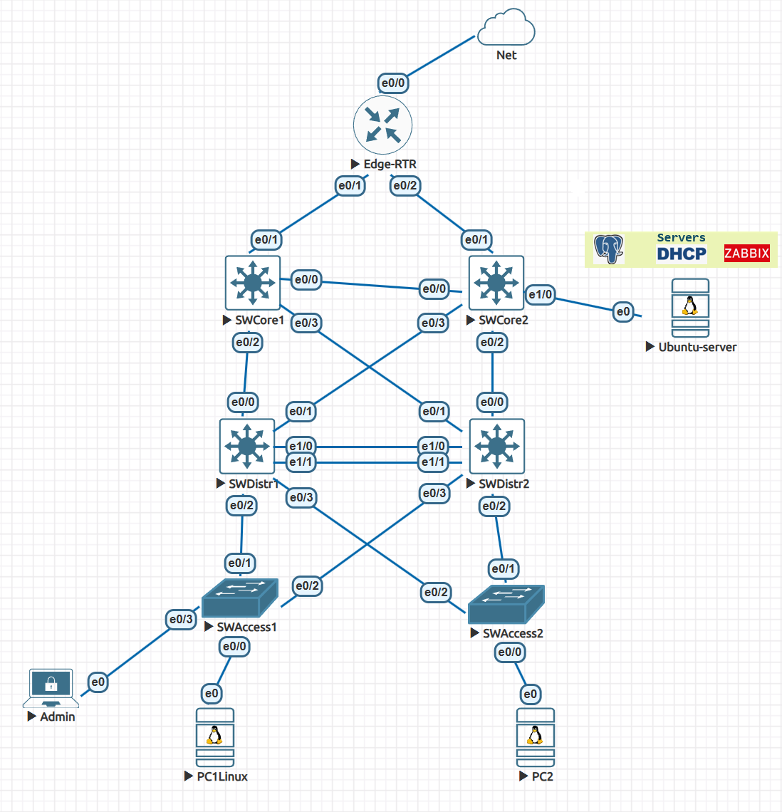 
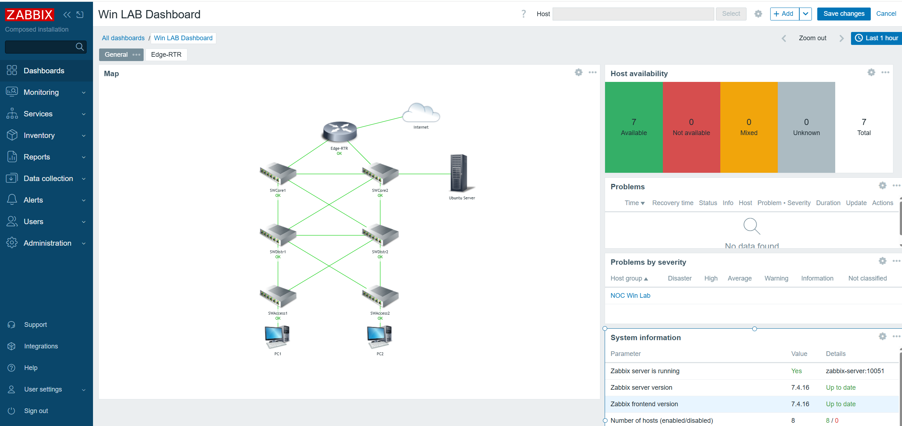
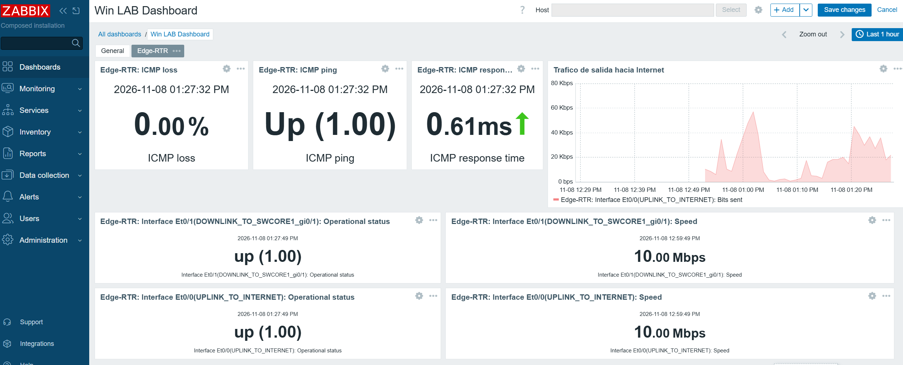

##  Descripción

En este laboratorio incorporamos uno de los programas open source de monitorización mas utilizados hoy en dia : Zabbix.
A esta topología que venimos utilizando le llamaremos Win's Lab.

Incorporamos Zabbix a nuestro Win's Lab para demostrar la importancia y obligación de monitorizar 24/7 nuestras redes y dispositivos.

Zabbix nos permite:
- Recopila métricas de rendimiento
- Analiza y detecta problemas en la red
- Nos permite generar reportes
- Automatización de respuestas ante incidentes


## Objetivo: 

1. Instalar Zabbix con Docker en nuestro Ubuntu Server
2. Configurar comandos SNMP en los dispositivos para que Zabbix pueda realizar las consultas a los equipos
3. Agregar hosts (Dispositivos) a Zabbix manual o mediante descubrimiento automático.
4. Crear un Dashboard donde podemos visualizar las métricas mas importantes
5. Algunas funciones adicionales como mapa de topología


## Notas de campo

Lo ideal es tener un conocimiento a nivel CCNA para saber que items o que parámetros deberíamos monitorizar en una red, asi podemos saber que es lo urgente y que lo importante.

Con Zabbix podemos integrar un monton de plugins, en este lab mostramos lo básico sin embargo podemos complementar con Grafana por ejemplo para paneles mas visuales u otras herramientas como automatización de alertas para que lleguen a un telegram, etc.

Zabbix nos permite támbien crear inventarios, reportes pero la verdad es bastante sencillo de implementar y util para poder tener un vistazo general de la red.


---

##  Topología de la Red
Microsoft Visio


###  Subnets

|Subnet|Descripción|
|:----|:----|
|10.255.255.0|Distri y Cores|
|10.254.100.0|Servers|
|10.254.16.0|Vlan Users|
|10.254.32.0|Vlan RRHH|
|10.254.99.0|Vlan Management|
|10.255.254.0|Cores y Edge-RTR|
|192.168.0.0|Red local del Host del Lab|

###  Device's Management IPs

|Dispositivo|Management IP| OSPF Router ID
|:----|:----|:----|
|SWCore1|10.255.255.1| 10.255.255.1 |
|SWCore2|10.255.255.2| 10.255.255.2 |
|SWDistr1|10.255.255.11| 10.255.255.11 |
|SWDistr2|10.255.255.12| 10.255.255.12 |
|SWAccess1|10.254.99.11|
|SWAccess2|10.254.99.12|
|Edge-RTR|10.255.254.1| 10.255.254.1 |
|Server|10.254.100.100|


###  Tabla de Direccionamiento 


|Dispositivo|Interfaz|Tipo de Puerto|VLAN|Dirección IP / Máscara|Gateway / Next-Hop|Vecino/ Puerto Destino|
|:----|:----|:----|:----|:----|:----|:----|
|SWCore1|Loopback 0|Logico|N/A|10.255.255.1/32|N/A|N/A|
| |Po1|Enrutado|N/A|10.255.255.13/30|10.255.255.14/30|SWCore2 (Po1)|
| |e0/0|Po1|N/A|N/A|N/A|SWCore2 (e0/0)|
| |e0/1|Po1|N/A|N/A|N/A|SWCore2 (e0/1)|
| |e0/2|Enrutado|N/A|10.255.255.21/30|10.255.255.22/30|SWDistr1 (e0/0)|
| |e0/3|Enrutado|N/A|10.255.255.25/30|10.255.255.26/30|SWDistr2 (e0/1)|
|SWCore2|Loopback 0|Logico|N/A|10.255.255.2/32|N/A|N/A|
| |Po1|Enrutado|N/A|10.255.255.14/30|10.255.255.13/30|SWCore1 (Po1)|
| |e0/0|Po1|N/A|N/A|N/A|SWCore1 (e0/0)|
| |e0/1|Po1|N/A|N/A|N/A|SWCore1 (e0/1)|
| |e0/2|Enrutado|N/A|10.255.255.29/30|10.255.255.30/30|SWDistr2 (e0/0)|
| |e0/3|Enrutado|N/A|10.255.255.33/30|10.255.255.34/30|SWDistr1 (e0/1)|
| |Vlan 100|SVI|100|10.254.100.1/24|10.254.100.100|Server (e/0)|
|SWDistr1|Loopback 0|Logico|N/A|10.255.255.11/32|N/A|N/A|
| |e0/0|Enrutado|N/A|10.255.255.22/30|10.255.255.21/30|SWCore1 (e0/2)|
| |e0/1|Enrutado|N/A|10.255.255.34/30|10.255.255.33/30|SWCore2 (e0/3)|
| |e0/2|Trunk|99,1116,1132|N/A|N/A|SWAccess1 (e0/1)|
| |e0/3|Trunk|99,1116,1132|N/A|N/A|SWAccess2 (e0/2)|
| |Vlan 99|SVI|99|10.254.99.2/24|HSRP 10.254.99.1/24|Gestión|
| |Vlan 1116|SVI|1116|10.254.16.2/24|HSRP 10.254.16.1/24|N/A|
| |Vlan 1132|SVI|1132|10.254.32.2/24|HSRP 10.254.32.1/24|N/A|
|SWDistr2|Loopback 0|Logico|N/A|10.255.255.12/32|N/A|N/A|
| |e0/0|Enrutado|N/A|10.255.255.30/30|10.255.255.29/30|SWCore2 (e0/2)|
| |e0/1|Enrutado|N/A|10.255.255.26/30|10.255.255.25/30|SWCore1 (e0/3)|
| |e0/2|Trunk|99,1116,1132|N/A|N/A|SWAccess2 (e0/1)|
| |e0/3|Trunk|99,1116,1132|N/A|N/A|SWAccess1 (e0/2)|
| |Vlan 99|SVI|99|10.254.99.3/24|HSRP 10.254.99.1/24 |Gestión|
| |Vlan 1116|SVI|1116|10.254.16.3/24|HSRP 10.254.16.1/24|N/A|
| |Vlan 1132|SVI|1132|10.254.32.3/24|HSRP 10.254.32.1/24 |N/A|
|SWAccess1|e0/0|Access|1116|N/A|N/A|PC1 Linux|
| |e0/1|Trunk|99,1116,1132|N/A|N/A|SWDistr1 (e0/2)|
| |e0/2|Trunk|99,1116,1132|N/A|N/A|SWDistr2 (e0/3)|
|SWAccess2|G0/0|Access|1132|N/A|N/A|PC2 VPC|
| |e0/1|Trunk|99,1116,1132|N/A|N/A|SWDistr2 (e0/2)|
| |e0/2|Trunk|99,1116,1132|N/A|N/A|SWDistr1(e0/3)|
| Edge-RTR    | e0/0     | Enrutado       | N/A  | 192.168.0.254          | 0.0.0.0            | Internet               |   |   |   |
|             | e0/1     | Enrutado       | N/A  | 10.254.253.2           | 10.254.253.1       | SWCore1 (e0/1)         |   |   |   |
|             | e0/2     | Enrutado       | N/A  | 10.254.253.6           | 10.254.253.5       | SWCore2(e0/1)          |   |   |   |

###  Configuración de dispositivos

Las configuraciones completas de cada dispositivo están disponibles en la carpeta [`configuraciones/`](./configuraciones):

|Dispositivo|Archivo|Descripción|
|:----|:----|:----|
|SWAccess1|[Config-SWAccess1.ios](./Configuraciones/Config-SWAccess1.ios)|Config Completa|
|SWAccess2|[Config-SWAccess2.ios](./Configuraciones/Config-SWAccess2.ios)|Config Completa|
|SWDistr1|[Config-SWDistr1.ios](./Configuraciones/Config-SWDistr1.ios)|Config Completa|
|SWDistr2|[Config-SWDistr2.ios](./Configuraciones/Config-SWDistr2.ios)|Config Completa|
|SWCore1|[Config-SWCore1.ios](./Configuraciones/Config-SWCore1.ios)|Config Completa|
|SWCore2|[Config-SWCore2.ios](./Configuraciones/Config-SWCore2.ios)|Config Completa|
|SWCore2|[Config-Edge-RTR.ios](./Configuraciones/Config-Edge-RTR.ios)|Config Completa|

###  Instalacion, Pruebas y Verificación

## -- Desplegamos Zabbix+Docker en nuestro Ubuntu Server --
###  1. Instalamos Docker
Instalar dependencias:

```
sudo apt install -y ca-certificates curl
```
Crear el directorio de claves:
```
sudo install -m 0755 -d /etc/apt/keyrings
```
Descargar la clave oficial de Docker:
```
sudo curl -fsSL https://download.docker.com/linux/ubuntu/gpg \
  -o /etc/apt/keyrings/docker.asc
```
Configurar permisos:
```
sudo chmod a+r /etc/apt/keyrings/docker.asc
```
Añadir el repositorio oficial:
```
echo \
  "deb [arch=$(dpkg --print-architecture) signed-by=/etc/apt/keyrings/docker.asc] https://download.docker.com/linux/ubuntu \
  $(. /etc/os-release && echo "${UBUNTU_CODENAME:-$VERSION_CODENAME}") stable" \
  | sudo tee /etc/apt/sources.list.d/docker.list > /dev/null
```
Actualizar e instalar Docker:
```
sudo apt update
sudo apt install -y \
  docker-ce \
  docker-ce-cli \
  containerd.io \
  docker-buildx-plugin \
  docker-compose-plugin
```

###  2. Verificar Docker
Comprobar las versiones:
```
docker --version
docker compose version
```
Comprobar el servicio:
```
sudo systemctl status docker
```
Probar Docker:
```
sudo docker run --rm hello-world
```
###  3. Descargar Zabbix Docker

Instalar Git:
```
sudo apt install -y git
```
Clonar el repositorio oficial:
```
git clone https://github.com/zabbix/zabbix-docker.git
```
Entrar en el directorio:
```
cd zabbix-docker
```
Seleccionar la rama 7.4:
```
git checkout 7.4
```
###  4. Levantar Zabbix con PostgreSQL

Levantar los servicios en segundo plano:
```
sudo docker compose -f compose_pgsql.yaml up -d
```
###  5. Comprobar los contenedores de Zabbix
Entrar en el directorio primero
```
cd zabbix-docker
```
Ver el estado de los servicios:
```
sudo docker compose -f compose_pgsql.yaml ps
```
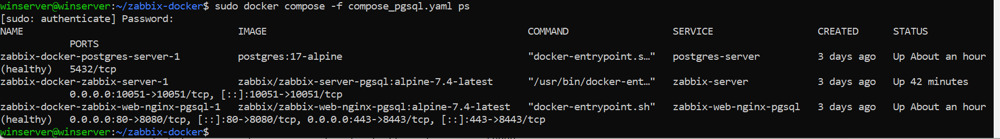


##  -- CONFIGURACION SNMP EN DISPOSITIVOS PARA QUE PUEDAN COMUNICARSE CON ZABBIX --

💡 En nuestro laboratorio tuvimos que crear un Port Forwarding NAT para poder conectarnos al Zabbix a su ip de gestión desde mi maquina real.

-Este comando se aplica en Edge-RTR
-La ip 192.168.0.245 es la ip de la interfaz de Edge-RTR que esta en la subred domestica que conectamos en Eve-NG para que nuestros dispositivos tengan comunicación con internet y con la subred domestica real.

Con este comando cualquiera que se comunique apuntando a 192.168.0.245 puerto 80, el Edge-RTR lo deriva a ubuntu server donde esta Zabbix y asi podemos conectarnos a la web de gestión.

```
! -- Para Acceder a Zabbix puerto 80 -- !
ip nat inside source static tcp 10.254.100.100 80 192.168.0.245 80
```

## Configuracion SNMP en dispositivos

Creamos una Lista de Control de Acceso (ACL) estándar que permite **única y exclusivamente** las peticiones provenientes de la IP `10.254.100.100` (la dirección del Servidor Zabbix).
```
access-list 10 permit host 10.254.100.100
```

Definimos una "vista" de seguridad llamada `NOC-VIEW`. que incluye el árbol `iso`, las variables o items en el arbol de objetos de un dispositivo se encuentran en este arbol, `iso` es como la carpeta raiz por lo que esta vista puede ver todos los parametros de un dispositivo (Interfaces,Operational Status,etc...)

```
snmp-server view NOC-VIEW iso included
```
Creamos el grupo `NOC-GROUP` usando **SNMPv3**. El parámetro **`priv`** obliga al grupo a utilizar el máximo nivel de seguridad (Autenticación + Cifrado). "Read" significa que el grupo solo puede leer los items, no modificarlos y el scope es NOC-VIEW, y tambien se indica la lista de acceso que restringe quien hace la consulta.

```
snmp-server group NOC-GROUP v3 priv read NOC-VIEW access 10
```
Y por ultimo se crea el usuario perteneciente al grupo que utilizara autenticacion y cifrado para poder hacer la consulta, el usuario es zabbix del grupo NOC-GROUP v3 (v3 es la version SNMP que es la version segura hoy en dia), se coloca el tipo de encriptacion y listo.
```
snmp-server user zabbix NOC-GROUP v3 auth sha u8cWQV+QHogDiCvLcN76mRsdGdQ= priv aes 128 gkUQpJ+pNZzlpLbJsx5KRQ6DSWg=
```
- Podemos crear las claves con este comando en Ubuntu:
```
openssl rand -base64 20
```
- Aplicamos a todos los dispositivos de nuestra red, aqui un ejemplo de aplicacion en uno de los dispositivos:

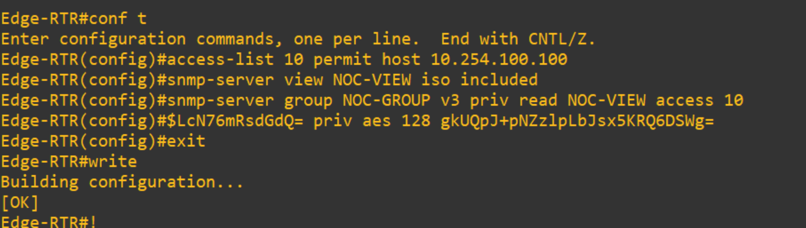

## COMPROBACION: conexion SNMP entre Zabbix y los dispositivos:

1. En nuestro Ubuntu Server donde tenemos el zabbix ejecutamos este comando:

snmpwalk -v3 -l authPriv \
  -u zabbix \
  -a SHA -A 'u8cWQV+QHogDiCvLcN76mRsdGdQ=' \
  -x AES -X 'gkUQpJ+pNZzlpLbJsx5KRQ6DSWg=' \
  10.255.255.1 \
  1.3.6.1.2.1.1.5.0

• snmpwalk: Aplicación de terminal para consultar de forma masiva la información de un dispositivo de red.

• -v3: Versión 3 del protocolo SNMP que añade seguridad criptográfica.

• -l: Nivel de seguridad authPriv (obliga a usar autenticación y cifrado de datos).

• -u: Nombre de usuario registrado en el dispositivo (zabbix).

• -a: Algoritmo de autenticación (SHA) para validar la identidad del servidor.

• -A: Contraseña secreta para la autenticación SHA.

• -x: Algoritmo de cifrado/privacidad (AES) para encriptar los datos transmitidos.

• -X: Contraseña secreta para el cifrado AES de 128 bits.

• 10.255.255.1: Dirección IP de gestión del dispositivo destino (Switch o Router).

• 1.3.6.1.2.1.1.5.0: OID exacto del item: sysName para extraer directamente el nombre del equipo.

### En este ejemplo apuntamos a SWCore1 y nos responde correctamente.

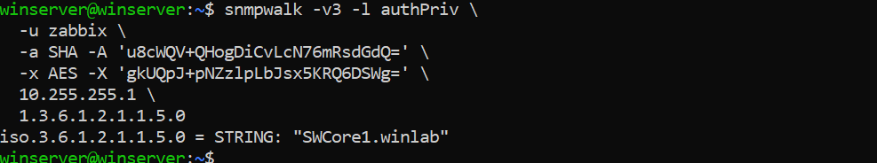

## -- ACCESO A ZABBIX Y MONITORIZACION --

Abrir desde el navegador de Windows:
http://192.168.0.245:80 
Credenciales predeterminadas de Zabbix:
Usuario: Admin
Contraseña: zabbix

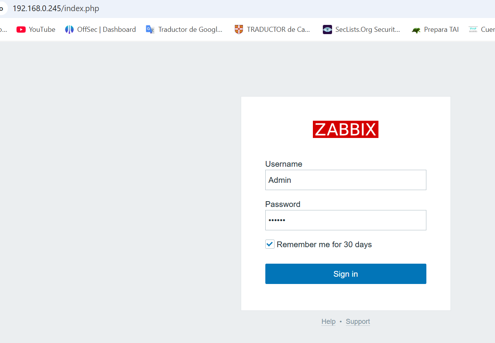

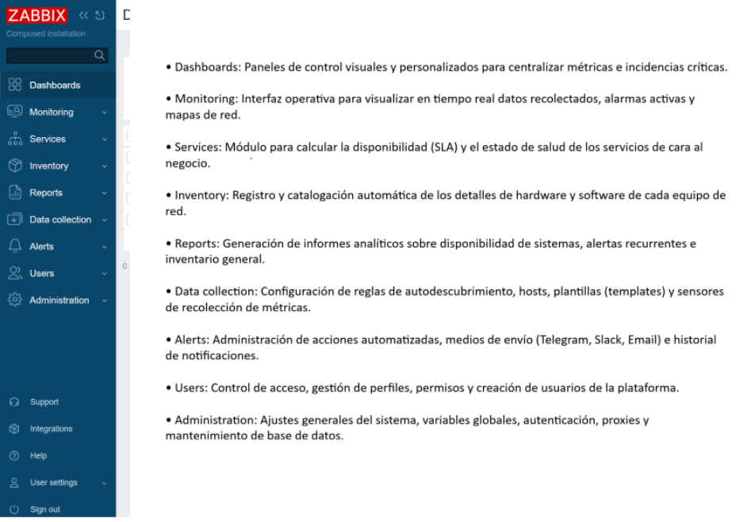

-----------------------------------------------------------------------
💡 Primer paso:  Vamos a crear un Host Group donde incluiremos a todos nuestros dispositivos de red de Win's Lab, luego haremos un descubrimiento automatico para que Zabbix detecte los Host, los agregue y ademas les asigne una plantilla que consulta sus metricas de una vez.

### 1. Creamos el grupo : Network Devices  en Data Collection>Host groups>Create host group

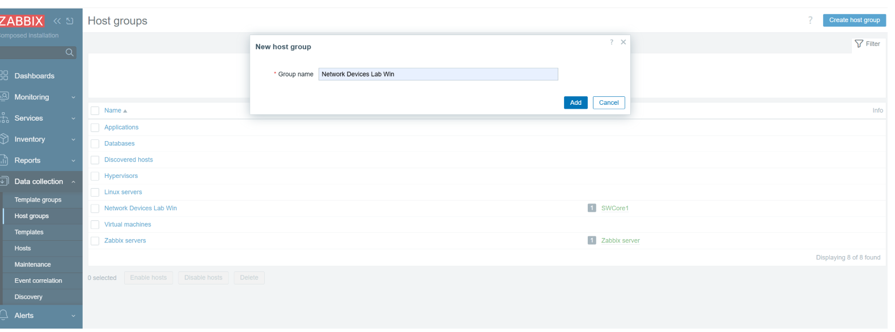

### 2. Creamos la regla Discovery (descubrimiento de hosts)  Zabbix>DataCollection>Discovery> Create discovery rule

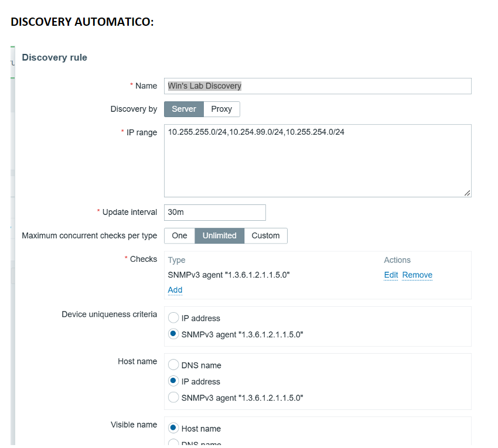

1.- Colocamos el nombre de la Discovery Rule y los rangos de ip

2.- Colocar el Discovery "Check" en add

3.- Escribe 1.3.6.1.2.1.1.5.0 (este OID le pide al switch su nombre de equipo).

4.- Rellenamos el usuario el nivel de seguridad, la autenticacion y la encriptacion y le damos ADD.


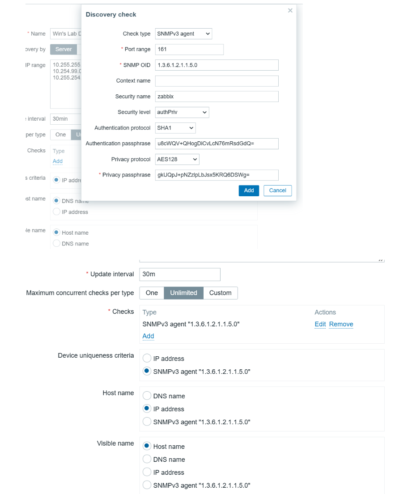

### 3. Verificamos que los host han sido descubiertos en Monitoring>Discovery Status
- Aqui hemos comprobado que efectivamente ya los host han sido descubiertos.

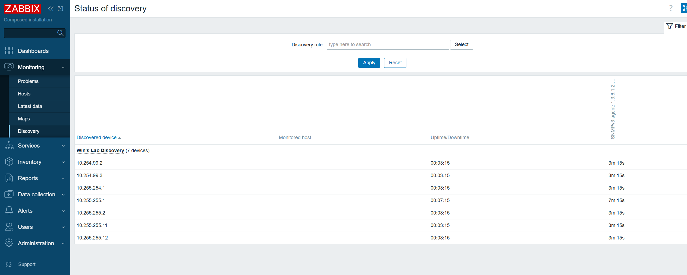

### 4. Creamos una regla que agregara automaticamente a los host descubiertos al Grupo que creamos y ademas les asignara la plantilla SNMP para ya obtener datos y poder monitorizar. Alerts>Actions>DiscoveryActions

- Type: Discovery Rule y seleccionamos la que creamos
- Agregamos las condiciones: Discovery rule equals "Wins'Lab Discover" , Discovery status equals UP (para que agregue los host activos)
- en Operations agregamos: "Add Host", "Add host to Group" (al grupo que hayamos creado, en nuestro caso: NOC Win Lab), Link Templates: Cisco IOS by SNMP
- Ejecutamos este comando en docker para aplicar lo anterior y que Zabbix aplique cambios
```
sudo docker exec -it zabbix-docker-zabbix-server-1 zabbix_server -R config_cache_reload
```

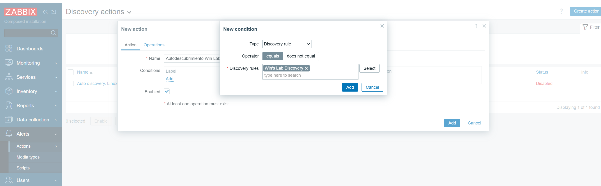
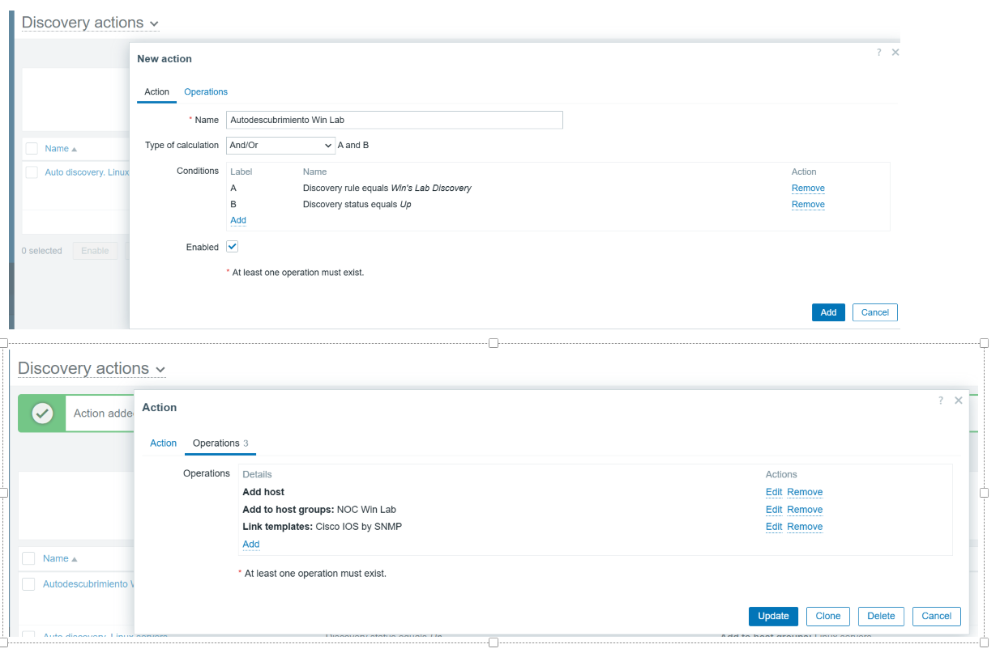

### 5. Comprobamos en Monitoring>Hosts y podemos ver que los Host ya estan activos en Verde (SNMP) y Zabbix esta recibiendo datos (Latest Data).

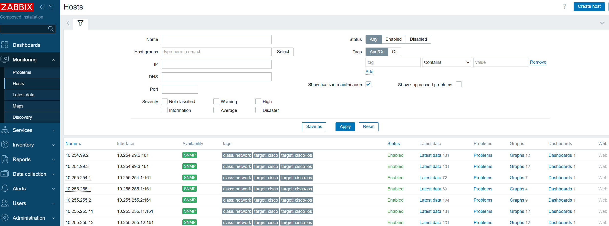

## Crearemos un Mapa de Topología y nuestro Dashboard para Monitorizar nuestros equipos

1. En Monitoring>Maps>Create Map : creamos el mapa, aumentamos un poco el tamaño: Width :1200 y Height: 700 y colocamos un nombre, hay otros campos que son opcionales.

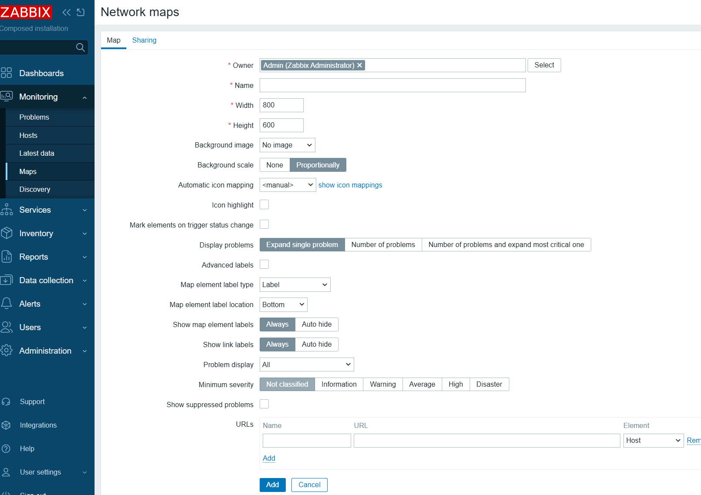


2. Luego le damos click al mapa creado y podemos agregar elementos, enlaces,  cambiarle el icono y lo mas importante debemos seleccionar el tipo como "Host" para que se sincronize con nuestro grupo de host. 

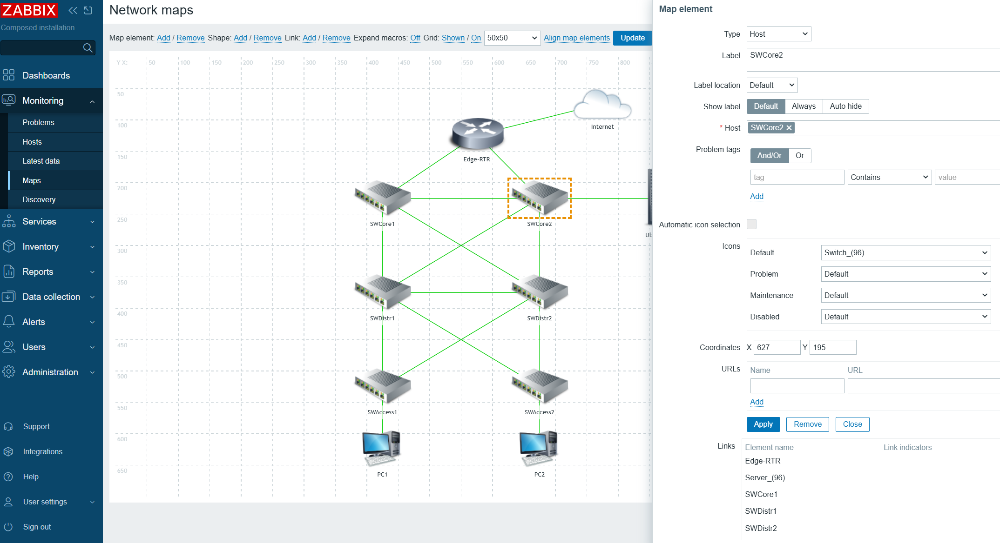

## Creamos el dashboard en: Dashboards>Create Dashboard

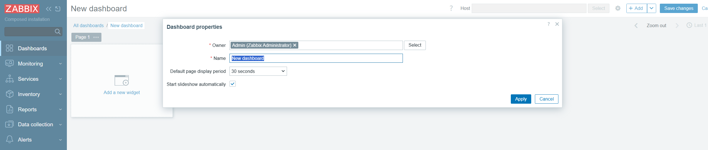

## Seleccionamos el Dashboard y editamos, aqui podemos ir agregando widgets, el mapa y los items que queremos monitorizar rapidamente.

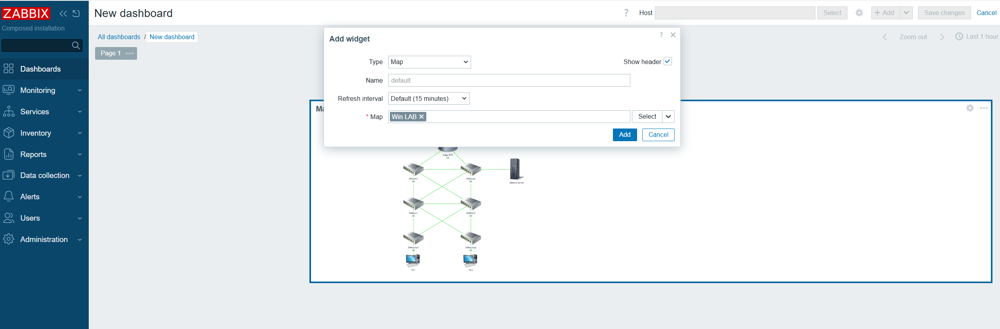

- Agregamos el Mapa
- Agregamos Problemas
- Agregamos Problemas por Severidad
- Status del servidor Zabbix
- y Otra pestaña con items especificos de un dispositivo por ejemplo : Estado de las interfaces, velocidad, respuesta de ping.

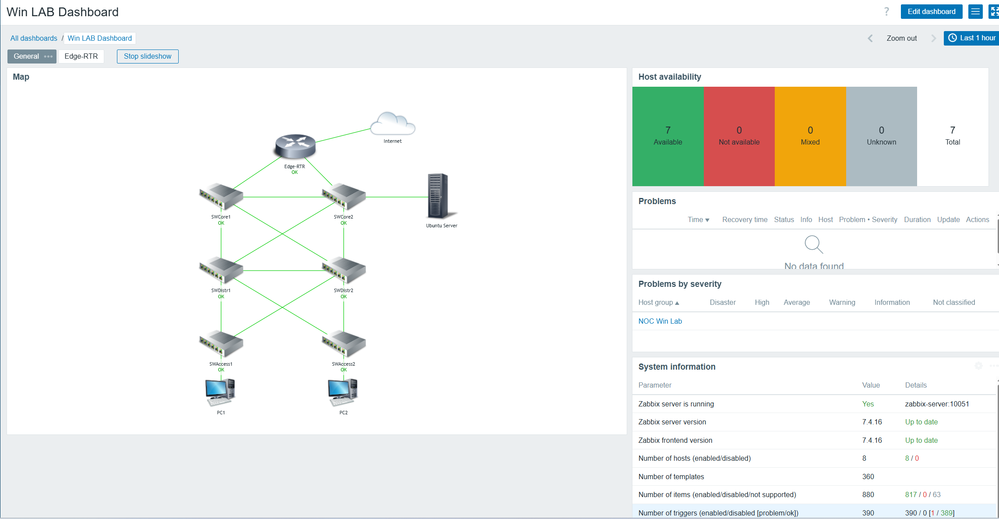

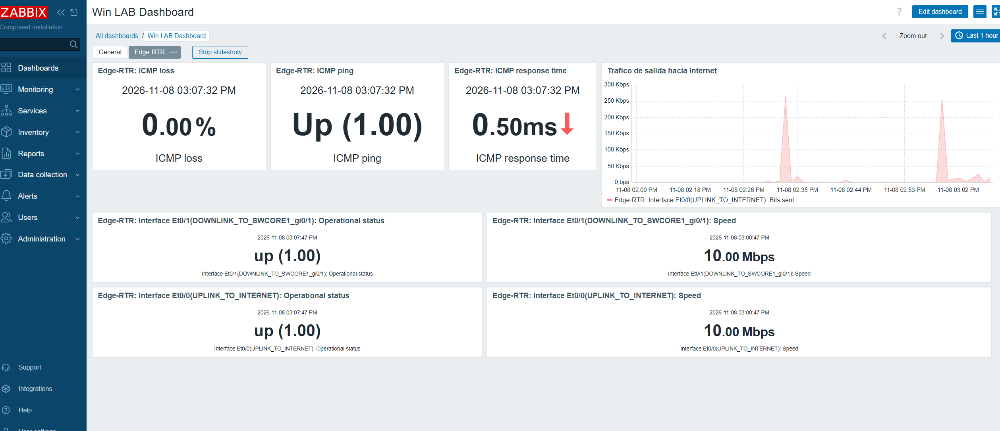


## En este punto ya tenemos nuestra red Monitorizada, ademas con Zabbix podemos realizar reportes, automatizar acciones, crear nuevas plantillas y crear un inventario con todos los datos especificos de los equipos.

## 🚩 Reflejamos aqui un problema para Monitorizar

Hemos deshabilitado el SWAccess1 apagando su interface de vlan99 y Zabbix inmediatamente detecta que el dispositivo no esta disponible y genera la alerta en problems: Cisco IOS: Unavailable by ICMP ping

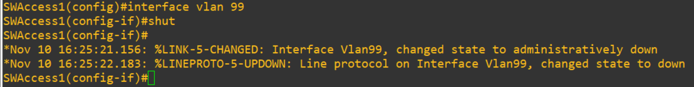

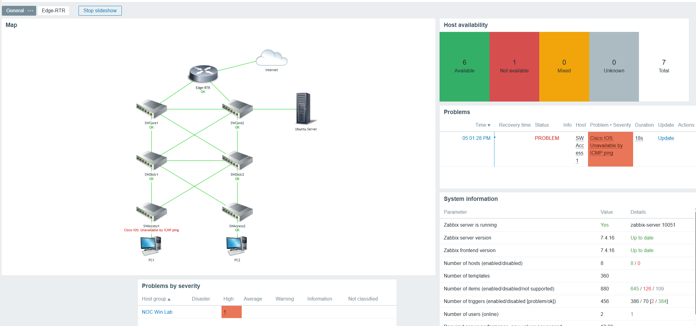

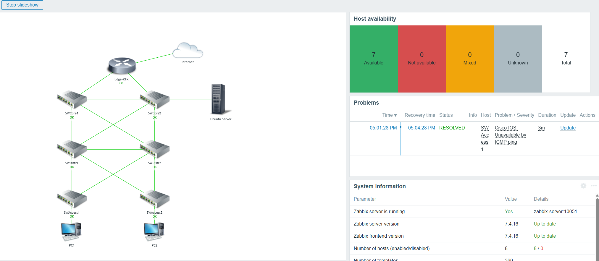

Luego que se levanta de nuevo la interfaz inmediatamente cambia de estado a RESOLVED


Caso Práctico de este supuesto: Detección y Recuperación de Incidente en Capa de Acceso (NOC) (Hecho con IA)

• Inicio del incidente (05:01:28 PM): Se simuló una pérdida de conectividad crítica en el switch de acceso SWAccess1. Tras tres comprobaciones fallidas consecutivas, Zabbix disparó automáticamente la alerta Cisco IOS: Unavailable by ICMP ping (severidad High), reflejando el cambio de estado de verde (OK) a rojo (PROBLEM) en el mapa topológico en tiempo real.

• Diagnóstico y aislamiento: Mediante el tablero de control se validó que los equipos de Distribución (SWDistr1 y SWDistr2) permanecían operativos, aislando el impacto exclusivamente al segmento de acceso afectado sin comprometer el núcleo de la red.

• Recuperación y cierre (05:04:28 PM): Al restablecer la interfaz de gestión del equipo, Zabbix validó nuevamente la conectividad ICMP/SNMP y cerró el evento automáticamente como RESOLVED, devolviendo la disponibilidad global al 100 % (7/7 hosts activos) con un tiempo total de interrupción (MTTR) de 3 minutos.


##  Skills Learned

Monitoreo y Observabilidad (Zabbix)

• Implementación de Zabbix 7.4 en Docker: Despliegue de arquitectura contenerizada sobre Ubuntu Server y gestión de acceso remoto mediante redirección de puertos (Port Forwarding / NAT estático).

• Monitoreo de Redes con SNMPv3 e ICMP: Configuración de recolección de métricas en tiempo real y descubrimiento automático de bajo nivel (LLD) para interfaces, estado operativo (ifOperStatus) y tráfico en dispositivos Cisco.

• Gestión de Disparadores (Triggers) y Severidades: Creación y ajuste de prototipos de alertas, comprensión de reglas de supresión (Overrides) por apagado administrativo y clasificación de incidentes según impacto.

• Visualización NOC y Reportes SLA: Diseño de mapas topológicos dinámicos en tiempo real, paneles de disponibilidad global y análisis de informes de SLA y tiempos de recuperación (MTTR).


